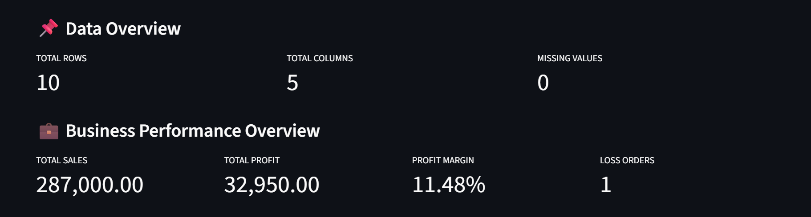
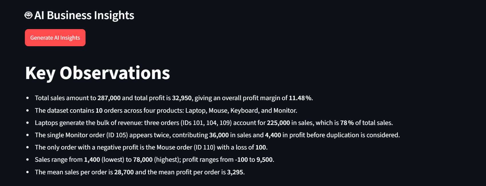
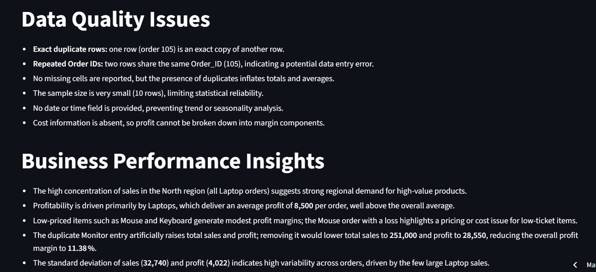
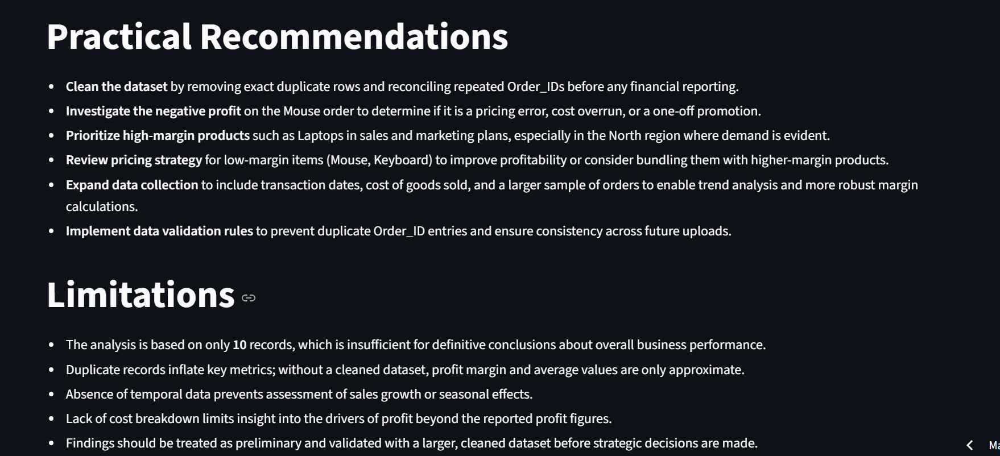
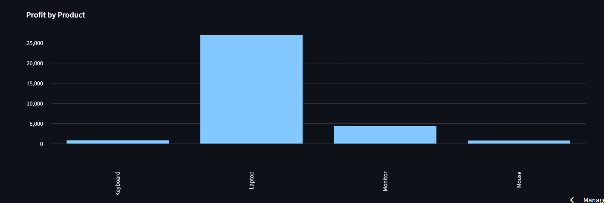
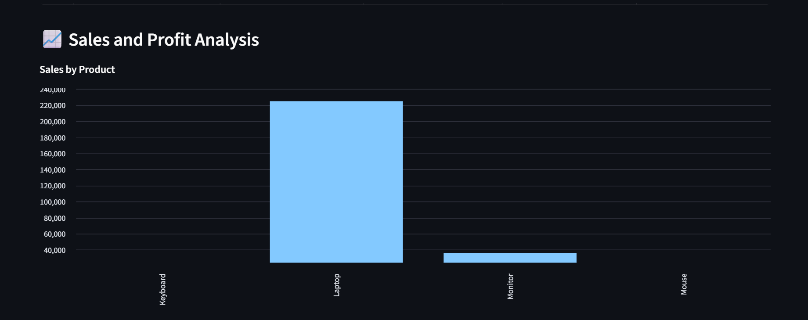

# 🔎 Data Detective AI

An AI-powered business data analysis application built with Python and Streamlit.

## 🚀 Overview

Data Detective AI helps users analyze business CSV files, identify common data quality issues, and generate AI-powered business insights.

## ✨ Features

- Upload business data in CSV format
- View dataset rows, columns, and missing values
- Detect exact duplicate records
- Identify repeated Order IDs
- Detect orders with negative profit
- Calculate total sales, total profit, and profit margin
- Visualize sales and profit by product
- Generate AI-powered business analysis reports
- Download analysis reports and CSV data

## 🛠️ Technologies Used

- Python
- Streamlit
- Pandas
- Groq API
- GitHub
- Streamlit Community Cloud

## 🌐 Live Demo

**Try the application:**  
[Add your Streamlit app link here]

## 💻 Run Locally

1. Clone this repository.
2. Install the required packages:

   ```bash
   pip install -r requirements.txt
   ```

3. Configure your Groq API key using Streamlit secrets.
4. Start the application:

   ```bash
   streamlit run app.py
   ```

## 🔐 API Configuration

Create a `.streamlit/secrets.toml` file and add your own API key:

```toml
GROQ_API_KEY = "your_api_key_here"
```

Never upload your actual API key to GitHub.

## 👨‍💻 Author

Developed as a Data Science portfolio project to demonstrate data analysis, data quality checks, visualization, and AI integration.

## 📸 Project Screenshots

### 1. Data Overview


### 2. AI Business Insights


### 3. AI Insights Detail


### 4. Data Quality Checks


### 5. Profit Analysis Chart


### 6. Sales Analysis Chart

